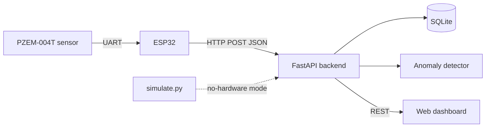

# IoT Power Monitor

Real-time electrical monitoring with an ESP32 and a PZEM-004T sensor. The ESP32 measures voltage, current, power, and energy, a FastAPI backend stores the readings in SQLite, and a web dashboard shows live charts and flags abnormal readings.

No hardware yet? Run the built-in simulator and everything else works the same.



## Features

- Live voltage, current, power, and energy (kWh) readout
- Two-layer anomaly detection (details below), with the reason stored for every flagged reading
- Hardware-free simulator that injects spikes and voltage sags
- Unit tests for the detector

## Quick start (no hardware)

```bash
python -m venv .venv && source .venv/bin/activate
pip install -r backend/requirements.txt

# terminal 1: backend + dashboard
cd backend && uvicorn main:app --reload

# terminal 2: fake data
python backend/simulate.py
```

Open http://localhost:8000. Run the tests from the repo root with `pytest`.

## Running with the ESP32

1. Install the **PZEM-004T-v30** library (Jakub Mandula) in the Arduino IDE, with ESP32 board support.
2. Copy `firmware/esp32_power_monitor/config.h.example` to `config.h` and set your WiFi and the backend's LAN address.
3. Wire PZEM TX to GPIO16 and PZEM RX to GPIO17, then upload the sketch.
4. Start the backend with `uvicorn main:app --host 0.0.0.0` so the ESP32 can reach it.

> **Safety:** the PZEM-004T measures mains voltage. Only wire the AC side with the power disconnected, use an enclosure, and never touch the AC terminals while powered. Test on a low-power load first.

## Anomaly detection

| Layer | Rule | Why |
|---|---|---|
| Hard limit | current > `MAX_CURRENT_A` (default 10 A) | overload or short-circuit protection |
| Hard limit | voltage outside 198–242 V | sag or surge |
| Statistical | rolling z-score of power, `|z| > 3` | unusual change relative to recent behaviour |

For power reading `x`, with mean `μ` and standard deviation `σ` over the last 60 normal readings:

```
z = (x − μ) / max(σ, 1 W)
```

Design choices worth knowing:

- The `1 W` floor on `σ` prevents false alarms when a load is almost perfectly flat.
- Flagged readings are not added to the window, so one spike does not distort the baseline.
- If a new level persists for 5 readings, it is accepted as a real load change (for example a heater turning on) and becomes the new baseline.

## API

| Method | Path | Description |
|---|---|---|
| POST | `/api/readings` | Submit a reading. Returns `{anomaly, reasons}` |
| GET | `/api/readings?limit=120` | Latest readings, oldest first |
| GET | `/api/anomalies?limit=20` | Latest flagged readings |

## Project structure

```
firmware/   ESP32 sketch (Arduino)
backend/    FastAPI app, anomaly detector, simulator
dashboard/  Single-page web UI (Chart.js)
tests/      Detector unit tests
docs/       Add your wiring photo and dashboard screenshot here
```

## Roadmap

- [ ] Add a wiring diagram and photos of the build to `docs/`
- [ ] MQTT transport instead of HTTP
- [ ] Alerts (Telegram or email) on anomalies
- [ ] Compare against an EWMA or Isolation Forest detector

## License

MIT
